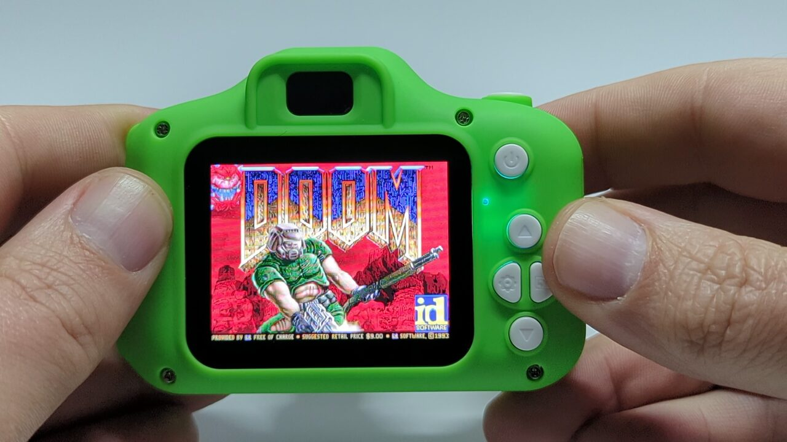
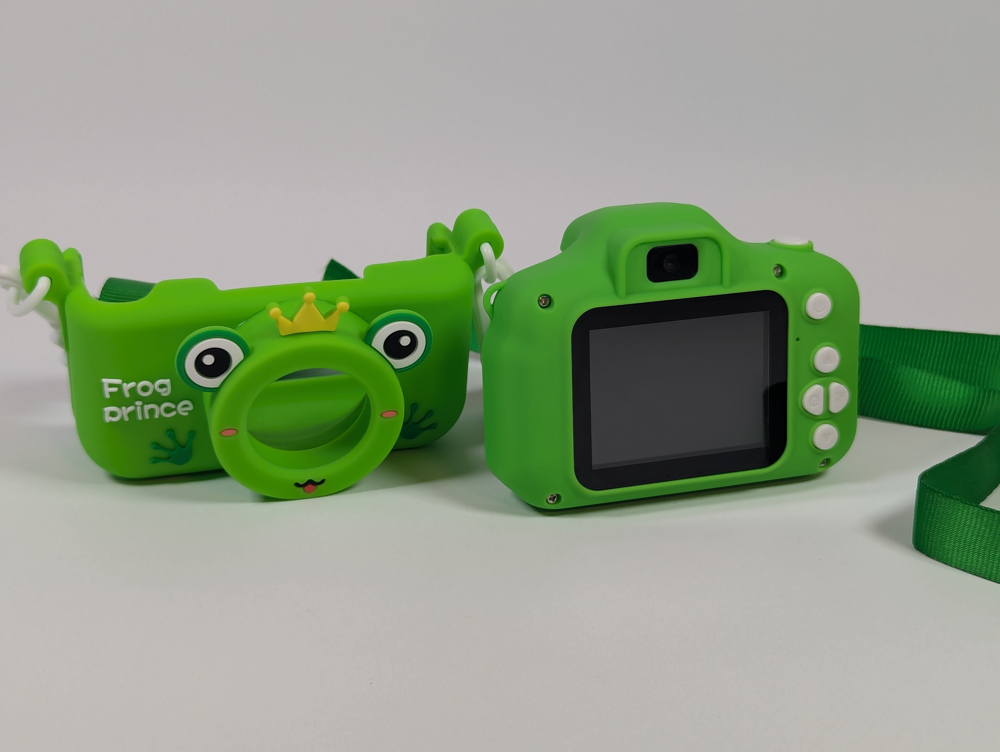

# HX3302B / "X9S children's camera": reverse engineering, SDK and Doom

A cheap, unbranded "Children's camera" (model **X9S**, USB `349c:3301`, SoC **HX-Tech HX3302B**, 4 MiB SPI flash) has been taken apart, documented,
given a C toolchain, and made to run Doom. This repository is *what we have*: the documentation, the tools, the SDK and the Doom port. It accompanies an article on my website, which tells the story of how we got here.

- **The accompanying article:** [Reverse Engineering a Children's Camera](https://spodesabode.com/articles/reverse-engineering-a-childrens-camera/)
- **Watch it run:** [Doom on the camera (YouTube)](https://www.youtube.com/watch?v=9zbToc-B2Ns)

**AI-assisted:** this project was orchestrated by Andrew Spode, who opened the camera, extracted the firmware, designed the methods and benchmarks, ran every
test on the hardware and directed the work. Claude Opus 5.5 and Kimi 3.1 did much of the heavy lifting: reading the disassembly, writing the tools and code,
and drafting the analysis. See [Credits](#credits).

We've chosen not to include our firmware dumps. They're only useful to someone who already has a camera with the same firmware, and if that's you,
step 1 below reads it straight off your camera over USB with a script, no programmer needed. Everything here works on that image.
To play Doom you'll also need a copy of `DOOM1.WAD`, the freely available shareware data file (version 1.9), which we can't include.

## What this repository is good for
Using this repository you can:
- **learn how the firmware and the SoC work**: the anatomy of a cheap camera, from the boot header and flash map to the UI modes, sound, display and
  input, with the evidence behind each claim (`docs/`);
- **dump the firmware off your own camera** over USB, with no programmer needed (`tools/usb_flash_read.py`);
- **patch your own firmware to run Doom**, or put it back to stock afterwards (`doom/hxdoom_patch.py`);
- **write and run your own programs** on the camera, with a working C toolchain, an SD-card program loader and an SDK (`toolchain/`, `sdk/`);
- **explore further**: use the notes and tools as a starting point for other cameras that share this SoC family.

## What is where

| Folder | What | Licence |
|---|---|---|
| [`docs/`](docs) | The camera as sold, flash map, SD-update logic, UI modes, sound/music/key analysis, a consolidated hardware reference, symbol list | CC BY 4.0 |
| [`tools/`](tools) | USB flash dumper (no programmer needed), offline model of the SD update check, string/resource renderer, symbol generator, Ghidra scripts | MIT |
| [`toolchain/`](toolchain) | Scripts that turn stock binutils 2.43.1 + GCC 14.2 into a little-endian, no-delay-slot OpenRISC compiler, and build newlib for it | GPL-3.0-or-later |
| [`sdk/`](sdk) | Our own SDK (not the manufacturer's; there is no public one): the SD-card program loader and kit (`hxsdk`: start-up code, linker script, service headers, `mkgame.py`), plus an emulator (`emu.py`) | MIT |
| [`doom/`](doom) | The Doom port: our platform layer and a patch script for doomgeneric | GPL-2.0-or-later |
| [`firmware/`](firmware) | Deliberately empty: put your own dump here as `dump.bin` (git-ignored) for the tools that use it | n/a |

Each folder (apart from `firmware/`) holds its own `LICENSE`, and every source file carries an SPDX licence identifier and copyright line.

## The hardware in one paragraph

OpenRISC 1000 (little-endian, no branch delay slots) at up to about 120 million simple instructions per second; 2 MiB RAM at `0x02000000` plus 64 KiB SRAM;
4 MiB SPI NOR flash mapped at `0x06000000` (the main code runs in place from it); a 320x240 8 bpp display layer with a settable palette; SD card
over SPI-like DMA. Sensor driver `mipi_BF20A1_vga`. Full details: [`docs/hardware-and-firmware-guide.md`](docs/hardware-and-firmware-guide.md),
[`docs/camera-specs.md`](docs/camera-specs.md).

## Requirements
- **Dumping the firmware needs Linux** (the USB dumper uses Linux's raw SCSI interface; a live Ubuntu USB stick will do) **or a chip flashing tool** such as an
  XGecu T48 with a SOIC-8 clip.
- **Building the Doom update from your dump** needs only Python 3 and works on any OS (it should; we've only tried it on Linux).
- **Rebuilding the toolchain or Doom from source** needs Linux (or WSL) and takes a while; most people won't need to, since prebuilt binaries are included.
- An SD card, and `DOOM1.WAD`.

## How to use it
1. **Read your camera's flash** (Linux, Python only, needs `sudo`): `sudo python3 -I tools/usb_flash_read.py cc-dump /dev/sgN firmware/dump.bin` (the full steps, including how to find `/dev/sgN`, are in [`doom/README.md`](doom/README.md)).
   This is (probably) firmware-specific: it works because the firmware has a vendor SCSI command that calls an address, and we have only tried it on one firmware build. See
   [`docs/experiments/flash-read-without-t48.md`](docs/experiments/flash-read-without-t48.md). A T48 + SOIC-8 clip also works. **Keep this file safe:
   it is your recovery image, and the internal photo store (flash `0x291000` to the end) holds any photos taken without an SD card.**
2. **Update by SD card:** the camera looks for `Xly100s.bin` in the SD root on every plain power-on and flashes it if its header time differs from the
   installed one. How that works: [`docs/updating-the-firmware.md`](docs/updating-the-firmware.md).
   **A bad flash can brick the camera; only a programmer recovers it. Always keep your dump.**
3. **Build the toolchain:** [`toolchain/`](toolchain), how it works and how to build it in [`toolchain/README.md`](toolchain/README.md).
4. **Run your own code:** [`sdk/`](sdk).
5. **Doom:** [`doom/`](doom). `doom/hxdoom_patch.py` builds the update file from your own dump with our prebuilt binaries (no compiler needed), and a `restore` mode puts your stock firmware back. **Read "Before you start" in [`doom/README.md`](doom/README.md) first: charge the battery, and dump before you flash.**

## Tested on
One camera: an X9S "Frog Prince", firmware `3030B-20A1-20A1 V1.1` (built 2024-07-01), using Linux and Python 3.10. Everything in `docs/` was worked out on that firmware. The whole Doom chain in
[`doom/README.md`](doom/README.md) has been followed from a stock camera: USB dump, `check`, `build`, copy to the card, flash, Doom running; and the restore image has put the stock firmware back. Other
firmware versions, other X9S batches and other operating systems are untested; expect the USB dumper in particular to be firmware-specific.

**Short on time?** Ask an AI coding assistant to read `doom/README.md` and follow it. The USB steps need `sudo`, so you'll have to run those two commands yourself.

## A note on vendor code
This repository documents the firmware but does not contain it: no firmware image, and no full disassembly listings either. We have not rewritten the
firmware in C, so a listing would be the vendor's code in another form. The analysis quotes short fragments as commentary, gives addresses so you can
follow along in your own Ghidra project, and `tools/ghidra_scripts/` regenerates any listing from your own dump.

## Credits
- **Andrew Spode**: orchestrated the project; physically opened the device and extracted the firmware; designed the methods and benchmarks; ran every test on
  the camera; and directed the work throughout.
- **Sprite_tm**, for his earlier write-up of a camera with the same SoC family. It told us what kind of CPU to expect, his Ghidra processor work (via a
  derived OpenRISC extension) let us disassemble the dump, and his EXIF-block trick gave us our first memory dumps. Details and links:
  [`docs/earlier-work-sprite_tm.md`](docs/earlier-work-sprite_tm.md).
- **Claude Opus 5.5** (Anthropic) and **Kimi 3.1** (Moonshot AI): did much of the heavy lifting under that direction: reading the disassembly, writing the
  tools, the SDK and the Doom port, and drafting the analysis (the hardware and firmware guide in `docs/` and the sound and music analysis are largely
  Kimi's). Claude Code was the working environment.
- **doomgeneric**, **Chocolate Doom** and **id Software**, for the Doom source and the shareware game.

## Status and limitations
Everything here was written for one firmware build (`3030B-20A1-20A1 V1.1`, 2024-07-01) on one camera. Statements in `docs/` are marked as read from
the disassembly or measured on the hardware where that was known; the offline model is not validated for other units. A similar camera with a
different firmware will need its own addresses. The header checksum algorithm is still unknown (the firmware never verifies it).
