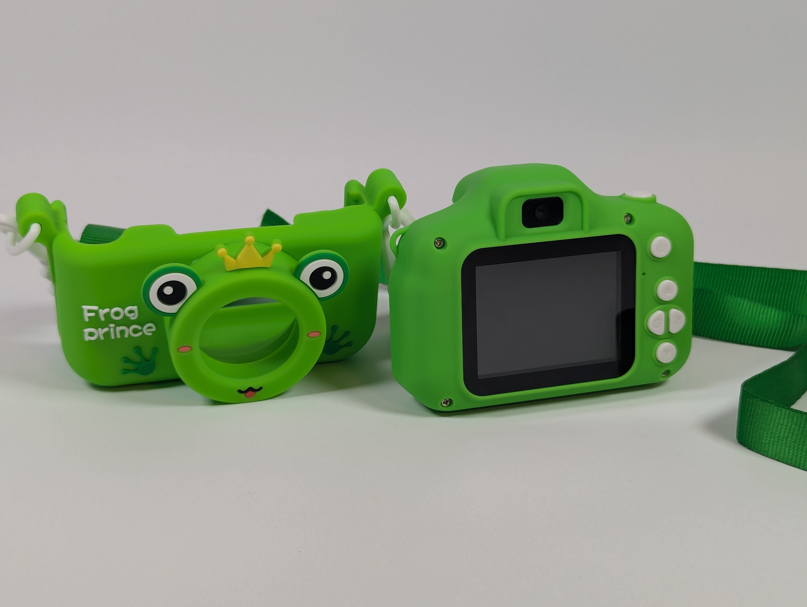
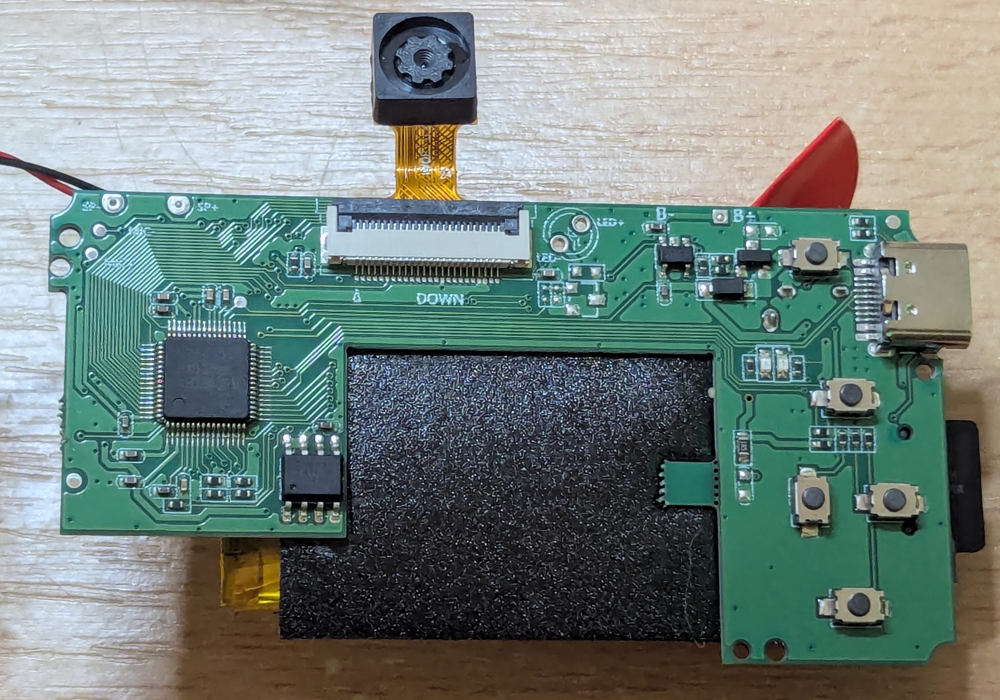
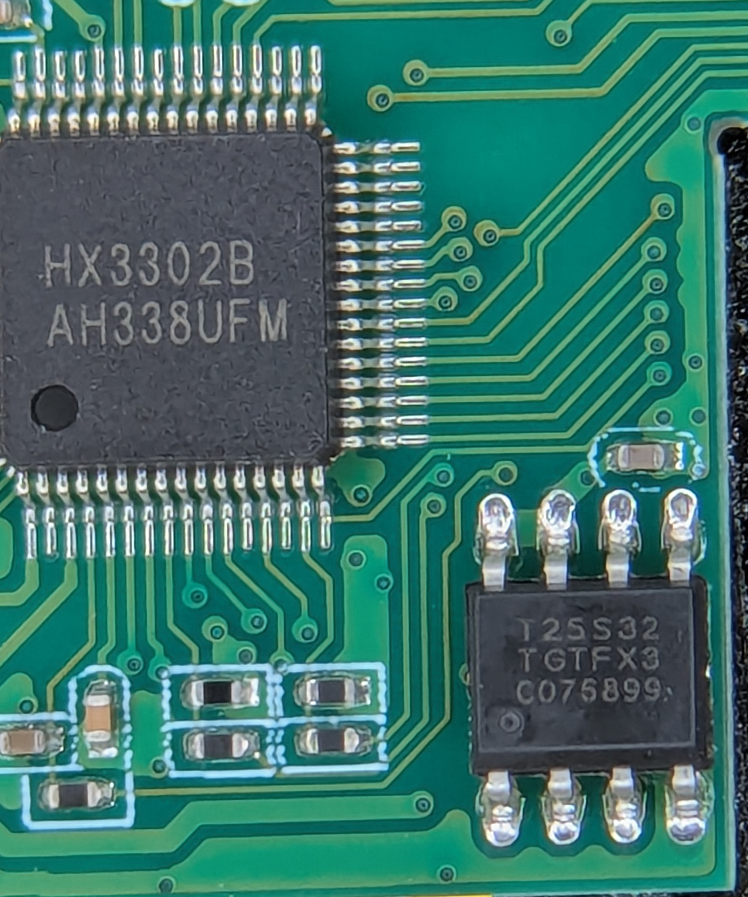

# Specifications and hardware photos

The camera in this project is sold as a **"Children's camera", model X9S**. The manual gives no manufacturer, brand, importer or address; the only
origin marking is "Made in China" on the back. This unit was bought in Hong Kong; the same camera is sold in the UK. The firmware identifies itself as
chip HX3302, version `3030B-20A1-20A1 V1.1`, build date 2024-07-01 (see the README), and the board is silkscreened `100S_V4.0`.

The table below is transcribed as printed from the "Production specifications" page (sic) of the camera's manual.

| Item | Manual says |
|---|---|
| Product name | Children's camera |
| Product model | X9S |
| Display screen | IPS 2.0 |
| Function | Photos, videos, games, music |
| Photo pixel | 40M, 20M, 18M, 16M, 12M, 8M, 5M, 3M, 2M |
| Resolution | 1080P, 720P |
| Video format | VGA |
| Camera memory | Support 16~51 card-free photos |
| Charging time | About an hour |
| Battery capacity | 400~600 mAh |
| Product weight | 62 g |
| Product size | 83 x 61 x 48 mm |
| Charging voltage | DC 5 V 1 A |
| Support memory | Supports up to 32 GB TF card storage |

## Measured performance
These come from our own benchmark programs (details and method in the [hardware and firmware guide](hardware-and-firmware-guide.md), section 2.5).

| What | Measured |
|---|---|
| CPU | about 82 million instructions a second in a loop with a taken branch, about 120 million in straight-line code |
| CPU caches | 8 KiB data, 8 KiB instruction; data inside the data cache reads and writes at about 164 MB/s (the instruction rate, not the memory) |
| Main RAM, read | about 65 MB/s |
| Main RAM, write | about 37 MB/s |
| `memcpy` | about 22.5 MB/s |
| Flash, data read | about 4.4 MB/s |
| Code run from flash | as fast as RAM while it fits the instruction cache; about 18 times slower when it does not |
| Code run from RAM | about 6 times slower when it does not fit the instruction cache |

## How the manual compares with the firmware
- **Photo pixels 40M ... 2M** cannot all be real sensor resolutions. The firmware's sensor driver is named `mipi_BF20A1_vga` and the manual says "Video format:
  VGA", which suggests a VGA-class sensor with the larger sizes scaled up, but we have not measured the sensor's native output, so treat that as likely
  rather than established. The firmware offers up to 1920x1080 over USB, and photos taken with the camera are 1280x960.
- **16~51 card-free photos** matches the internal photo store in flash (0x291000 to the end of the 4 MiB chip; the range depends on image size).
- **Games, music** match the 5 built-in games and the sound/music resources in the firmware.
- **TF card up to 32 GB**: a 64 GB card was formatted by the camera and its interface showed 64 GB capacity. It has not been filled, so whether data beyond 32 GB is stored
  correctly is untested.
- The weights and dimensions (62 g, 83x61x48 mm) describe a unit in its silicone case.

## Inside

The board (silkscreen `100S_V4.0`) carries the SoC and flash on the left, the camera module on a short flex cable at the top, the USB-C socket and
five tact switches on the right, the display flex connector at the top centre,
and the micro SD slot at the far right edge. The LiPo battery sits under the black foam pad.

| Part | Marking | Notes |
|---|---|---|
| SoC | `HX3302B` / `AH338UFM` | 64-pin QFP-style package (LQFP). Marked HX3302B, the firmware calls itself HX3302 |
| Flash | `T25S32` / `TGTFX3` / `C075899` | 8-pin SOIC SPI NOR, JEDEC ID `C4 60 16`, 4 MiB (32 Mbit) |
