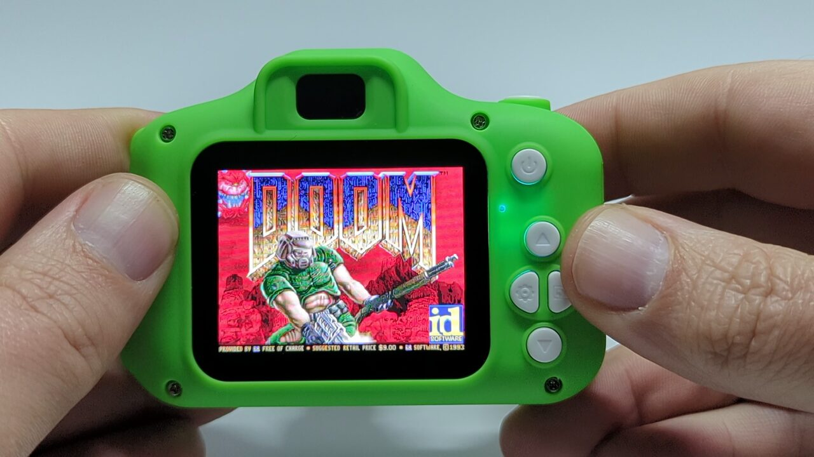

# Doom on the HX3302B "X9S" camera



**Watch it run:** [Doom on the camera (YouTube)](https://www.youtube.com/watch?v=9zbToc-B2Ns)

Doom (shareware episode 1) running on the camera's own hardware: Games button -> Doom, with sound effects, music, save games and the camera's
buttons as controls, at roughly 26-32 fps on a ~120 MIPS OpenRISC with 2 MiB of RAM.

**You need:** your own flash dump of an X9S camera on stock firmware `3030B-20A1-20A1 V1.1` (2024-07-01), Python 3, an SD card, and `DOOM1.WAD`
(id Software's freely available shareware, version 1.9, which can't be bundled here). The patcher builds the update from *your* dump of the camera's
firmware, so there's nothing else to download.

## Before you start
- **Charge the camera fully.** The update runs from its battery. A power cut during the flash can brick the camera, and only a programmer then recovers it.
- **Keep your dump.** Restoring flashes your dump back, so it has to be a dump of the stock firmware: take it before you install Doom and keep it somewhere safe.
  A dump taken after Doom is installed would restore Doom, so the patcher refuses it.
- **Doom overwrites the camera's internal photo storage.** Photos taken without an SD card are lost, and they can't be copied off over USB (the camera only exposes
  its SD card). Photos on the SD card are not affected.

## Quick start
Run these from this folder (`doom/`). Files stay in `../firmware/`, which git ignores. Plug the camera into your computer with its USB cable first; it shows up as a
USB disk called "Generic Mass-Storage".

```sh
# 1. Read your camera's flash (Linux). Find the camera's SCSI generic device: look for the disk with model "Mass-Storage", then ask sysfs for its sg name
lsblk -o NAME,VENDOR,MODEL            # e.g. sde  Generic  Mass-Storage
ls /sys/block/sde/device/scsi_generic/ # prints e.g. sg5  ->  /dev/sg5   (it can change when you plug the camera in again)

sudo python3 -I ../tools/usb_flash_read.py inquiry /dev/sg5                        # check it is the camera: it should say "Generic Mass-Storage"
sudo python3 -I ../tools/usb_flash_read.py cc-dump /dev/sg5 ../firmware/dump.bin   # KEEP THIS FILE. It takes about ten seconds and prints its progress.
# (if the camera hangs: unplug it, power-cycle it and try again)

# 2. Check the dump and build the update from it
python3 -I hxdoom_patch.py check --dump ../firmware/dump.bin        # should say "OK: this is the stock firmware"
python3 -I hxdoom_patch.py build --dump ../firmware/dump.bin -o ../firmware/Xly100s-doom.bin
```
3. **Flash it.** Copy `Xly100s-doom.bin` to the root of the camera's SD card **named exactly `Xly100s.bin`**, together with `DOOM1.WAD`. (While the camera is plugged in,
   its card is the "Generic Mass-Storage" disk, so you can copy to it directly.) Eject the card, **unplug the USB cable**, and press the power button.
   The camera only checks for an update on a normal power-on, not when it starts from the charger. You should see a progress bar, then "bye bye", and the camera powers itself
   off: **don't touch it until it has**. Switch it on again, choose **Games**, and Doom starts. (If you get a solid red screen, Doom has hit a fatal error; the most likely
   cause is a missing or wrong `DOOM1.WAD`.) `Xly100s.bin` can stay on the card: the camera ignores an update that matches what is installed.

**To go back to stock:**
```sh
python3 -I hxdoom_patch.py restore --dump ../firmware/dump.bin -o ../firmware/Xly100s-restore.bin
```
Copy that to the card as `Xly100s.bin` (replacing the Doom one), unplug USB and power on, the same way. `restore` puts back the firmware below `0x290000` only: your settings
are untouched, and photos that Doom overwrote do not come back. If the camera is already on the stock firmware it quietly ignores the file. A failed flash can brick the camera;
only a programmer then recovers it. This has worked on one camera; there are no guarantees.

## Controls
Up/down walk while held, left/right turn, the shutter button fires. A power-button tap changes weapon; holding power for about half a second is Escape (the
menu). Quit in Doom's menu powers the camera off. Doors and switches are used automatically when you walk into them ("bump to use"). In menus the
shutter is Enter and up/down move the cursor; Quit powers the camera off. Saves are written to the card root as `doomsav0-7.dsg`.

## What is in this folder
| File | |
|---|---|
| `hxdoom_patch.py` | the patcher (`build`, `restore`, `check`) |
| `MUSIC.md` | the music options we compared (MUS synth, OPL2, ADPCM, the firmware's MP3 decoder) and what we chose |
| `NOTES.md` | technical notes: memory layout, video, controls, sound, performance, and what the crashes taught us |
| `release/` | our prebuilt binaries: `DOOM.FLASH.BIN` (the Doom image placed at flash `0x2A0000`), `loader.bin` + `loader.syms` (the game host in the Fly slot), with `SHA256SUMS` |
| `hx_doom.c`, `hx_sound.c`, `hx_music.c`, `hx_syscalls.c`, `hx_stack.S` | the platform layer for [doomgeneric](https://github.com/ozkl/doomgeneric): video, keys, timing, sound, music synth (MUS), stdio on the card |
| `patch_doomgeneric.py` | the edits applied to doomgeneric's sources (git `e257a09`) |
| `mksplit.py`, `build.sh`, `build_flash.sh` | link script generation (code split between flash and fixed RAM) and the build |

## How it works, briefly
The firmware runs most of its code in place from memory-mapped flash. We sacrifice the "Fly" mini-game's slot for a small loader (`../sdk/loader/host.c`)
that runs a program with its own main loop, and make the Games button open it directly, skipping the game menu. Only Fly's code is overwritten; the other four games (2048, Maze, PushBox, snake) are still in flash but can no longer be reached. Doom's code is split: cold code runs in place from flash at `0x2A0000`
(only fast while it fits the instruction cache, so hot code is copied to fixed RAM at boot). Details: `NOTES.md`,
`../docs/hardware-and-firmware-guide.md`.

## Rebuilding the binaries
You do not need to rebuild to use Doom; `release/` holds the binaries the patcher uses, and the camera's own firmware only comes into it through your dump. The source and build scripts are here so the binaries can be reproduced and changed.

1. The build downloads and builds its own compiler and newlib on first use (`../toolchain/setup.sh`, 30-60 minutes, into `../out/toolchain`), or set `OR1KLE` to an existing install.
2. `DOOM_DEFS=-DHX_RELEASE ./build_flash.sh` (run from this folder). `build.sh` fetches doomgeneric at git `e257a09` into `../out/deps/` on first use; set `DOOMSRC` to use your own checkout.

`profile/` holds the measurement that decides which Doom code lives in RAM and which runs from flash: how often each address ran in the emulator during a demo (`profile.bin`), and the symbol map of that build (`profile.map`).
It describes only our own build of Doom and contains nothing from the camera's firmware. Both files belong to one build of the source: change the source and the addresses move, so the split is then no longer accurate (it still
builds, but may not fit). Regenerating the profile with the emulator (`../sdk/hxsdk/emu.py`, `EMU_PROFILE`) is not yet reliable.
Source paths are mapped to `./` when compiling, so the result does not depend on where the repository is checked out.

## Credits
The port is built on [doomgeneric](https://github.com/ozkl/doomgeneric) by ozkl, which carries id Software's original Doom source and Simon Howard's Chocolate Doom code. The music in the
audio clips and the shareware game data belong to id Software and the composer, Bobby Prince.

## Licence
GPL-2.0-or-later (Doom is GPL v2; our platform layer links into it). `LICENSE` is the GPL v2 text. The prebuilt `release/` binaries are built from
this source plus doomgeneric (GPL v2, https://github.com/ozkl/doomgeneric) and Chocolate Doom code.
